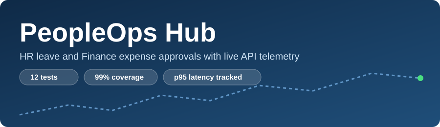
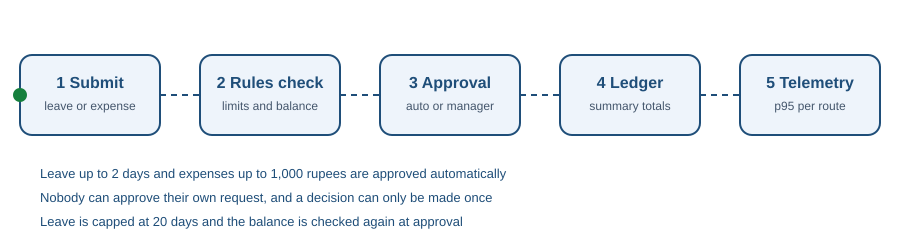

<p align="center"></p>

<p align="center">
  <a href="https://peopleops-hub.onrender.com"></a>
</p>
<p align="center">
  
  
  
  
  
  
</p>

## 30 second tour
1. Open the **[live demo](https://peopleops-hub.onrender.com)**. It loads with sample data. The free server may take about 50 seconds to wake up on the first visit.
2. Submit a 2 day leave request. It is **approved automatically**.
3. Submit an expense of 5000. It waits for a manager. Click **Approve** with a different name in "Signed in as".
4. Approve your own request. The app **blocks it**.
5. Watch the **p95 latency bars** update as you click around.

## How it works
<p align="center"></p>

## Features
| Area | What it does |
|---|---|
| HR (Employee Success) | Leave requests, 20 day yearly balance, balance hint while typing |
| Finance | Expense requests, approval rules, ledger summary of approved spend |
| Workflow | Auto approval below limits, manager approval above, no self approval, one decision per request |
| Telemetry | Middleware records every route and reports count, average and p95 latency at `/metrics` |
| Dashboard | KPI cards, status filters, toasts, dark mode, works on a phone |

## Quality
- **12 automated tests**, **99% coverage**, and a **90% coverage gate** in GitHub Actions CI.
- Tests cover approval rules, self approval, double decisions, leave balance, validation errors, filters, summary totals and telemetry.

## Design decisions
- **Balance is checked twice:** when a request is created and again when it is approved. Two pending requests can therefore never spend more than 20 days (covered by `test_approval_rechecks_balance`).
- **Telemetry groups by route template**, such as `/requests/{rid}/decision`, so p95 is not split across every request id.
- **Rules are plain constants** (`LEAVE_ALLOWANCE`, `LEAVE_AUTO_DAYS`, `EXPENSE_AUTO_LIMIT`), so a policy change is one line.

## API
| Method | Path | Purpose |
|---|---|---|
| POST | `/requests` | Create a leave or expense request |
| POST | `/requests/{id}/decision` | Approve or reject a pending request |
| GET | `/requests?status=pending` | List requests, optionally filtered |
| GET | `/employees/{name}/leave-balance` | Remaining leave days |
| GET | `/summary` | Counts and approved expense total |
| GET | `/metrics` | Latency per route (count, average, p95) |
| GET | `/docs` | Interactive API documentation |

## Run locally
```
pip install -r requirements.txt
python -m uvicorn app.main:app --reload
python -m pytest --cov=app
```
Then open `127.0.0.1:8000` in your browser while the server is running on your own computer. Set `SEED_DEMO=1` to start with sample data. To try the app without installing anything, use the live demo above.

## Built by
**Shaik Mohammed Umar** · [LinkedIn](https://linkedin.com/in/mohammed-umarshaik) · [GitHub](https://github.com/shaikumar11) · umarshaikno1@gmail.com
